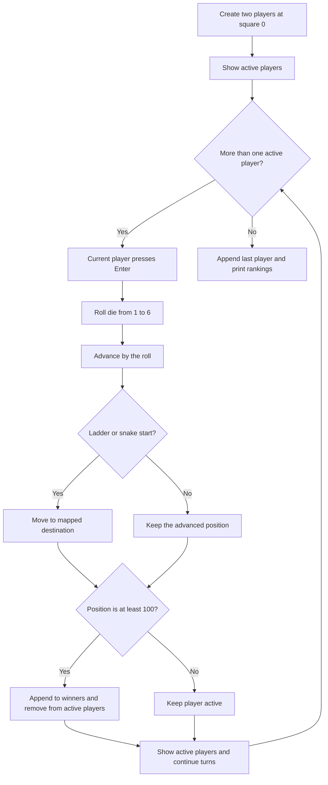

# Saap Aur Seedhi

A small terminal-based Snake and Ladders game written in C++. Players take turns rolling a six-sided die and moving along a 100-square track. Landing on a ladder moves a player forward; landing on a snake moves them backward. The game records finish order and prints the rankings when play ends.

This README describes what the current program does, how its pieces work together, and how to use the same ideas when building a similar turn-based game.

## At a glance

| Item | Current implementation |
| --- | --- |
| Language | C++ |
| Max. Players | 4 |
| Starting square | 0 |
| Die | Pseudo-random value from 1 to 6 |
| Track end | 100; reaching or passing it finishes the player |
| Special squares | 5 ladders and 5 snakes |
| Input | Press Enter when prompted to roll |
| Display | Text status lines and a short dice animation |

## Build and run

The source file is [`SaapAurSeedhi.cxx`](./SaapAurSeedhi.cxx). With GCC or MinGW installed, open a terminal in this folder and run:

```sh
g++ -std=c++11 -pthread SaapAurSeedhi.cxx -o SaapAurSeedhi
```

Then start the executable:

```sh
./SaapAurSeedhi
```

On Windows, the executable can be named with an `.exe` extension:

```powershell
g++ -std=c++11 -pthread SaapAurSeedhi.cxx -o SaapAurSeedhi.exe
.\SaapAurSeedhi.exe
```

The program uses `<thread>` and `<chrono>` for the dice animation. The cursor-control escape sequence used to refresh the prompt may not render the same way in every terminal.

## How to play

1. The program creates Players at square 0.
2. Players take turns in order. When a player's name is shown with `ROLL!`, press Enter.
3. The die animation runs, and the program generates a value from 1 through 6.
4. The player moves forward by that many squares.
5. If the new square is a ladder start or snake start, the player moves to its paired destination.
6. A player who reaches or passes square 100 is added to the finish-order list and removed from active play.
7. When only one player remains, that player is added last. The rankings are then printed.

### Rule details that matter

- The player starts at **0**, so the first roll advances them from 0.
- A player wins by reaching **100 or more**. The program does **not** require an exact roll to land on 100.
- Snakes and ladders activate only when the player's position after the roll exactly matches a start square.
- Rolling a six does not grant another turn.
- The game does not draw a conventional numbered board. Its status output shows a short text bar based on each player's position.

## Board mapping

The special squares are stored as matching start and destination arrays in `update()`:

| Type | Start | Destination | Effect |
| --- | ---: | ---: | --- |
| Ladder | 5 | 45 | Climb forward |
| Ladder | 15 | 24 | Climb forward |
| Ladder | 77 | 88 | Climb forward |
| Ladder | 85 | 91 | Climb forward |
| Ladder | 43 | 99 | Climb forward |
| Snake | 17 | 7 | Slide backward |
| Snake | 34 | 14 | Slide backward |
| Snake | 72 | 40 | Slide backward |
| Snake | 48 | 29 | Slide backward |
| Snake | 93 | 81 | Slide backward |

```text
Roll the die
    |
    v
position = position + roll
    |
    +---- position matches a ladder start? ---- yes ---> move to ladder destination
    |
    +---- position matches a snake start? ------ yes ---> move to snake destination
    |
    v
position >= 100?
    |
    +---- yes ---> record finish place and remove from active players
    |
    +---- no ----> player remains active
```

## Code organization

The program is a single source file. Its main parts are the player data and storage, small array operations, display and dice helpers, board movement, and the game loop.

### 1. Player data and game state

```cpp
struct Player {
    int position;
    string name;
};

Player List_of_Players[4];
int size = 0;

Player Winners[3];
int rank = 0;
```

- `Player` groups the two pieces of information that change or are displayed during play: the player's square and name.
- `List_of_Players` is a fixed-capacity array of active players. Maximum 4.
- `size` is the number of active entries in that array. It also identifies the next free slot when adding a player.
- `Winners` stores players in the order in which they finish. `rank` is the number of entries currently stored.
- `on_roll` is a global that carries the most recent die result into `update()`.

The arrays are fixed-size rather than dynamically sized. When adapting the program, keep each capacity consistent with the maximum number of players and possible finishers.

### 2. Adding and removing array entries

`add_to()` checks that there is room, writes a player at the next free index, and increments the array's size:

```cpp
if (size >= 0 && size < capacity) {
    array[size] = P;
    size++;
    return true;
}
```

`remove_from()` removes an active player by shifting every later entry one place to the left, then reducing the size:

```cpp
for (int i = index; i < size - 1; i++) {
    array[i] = array[i + 1];
}
size--;
```

Shifting keeps the active entries packed from index 0 through `size - 1`, which makes the turn loop straightforward. The caller must account for the shift: after removing the current player, `main()` decrements its loop index so that the player shifted into that index still gets their turn.

Both helpers return `bool` to indicate success and print an error if the requested operation cannot be performed.

### 3. Displaying active players

`display()` prints a heading, the number of players, and one line per active player. Each line includes the name and position. It also prints one `|` for each five squares, giving a rough progress indicator:

```cpp
cout << " " << array[i].name << " @" << array[i].position << "\t"
     << string((array[i].position / 5), '|');
```

For example, a player at square 20 gets four bars. A `*` is printed for positions at or above 90. This is a progress hint, not a scaled or numbered board.

### 4. Rolling the die and animation

`dice_roll()` pauses for one Enter keypress, refreshes the prompt using terminal cursor escape codes, runs `Animation()`, and generates the die value:

```cpp
int value = (rand() % 6) + 1;
return value;
```

`Animation()` cycles through `|`, `/`, `-`, and `\`. Each symbol is displayed for 100 milliseconds, producing a brief visual pause before the result appears.

At the beginning of `main()`, `srand((unsigned int)time(NULL))` seeds the pseudo-random generator with the current time. This makes successive program runs generally produce different rolls. The `rand() % 6` approach is simple and suitable for this small demonstration; it can have a slight distribution bias.

### 5. Applying movement, snakes, and ladders

`update(Player &player)` receives the current player by reference, so changes to `player.position` update the original player in the array. It first adds the global die result:

```cpp
player.position = player.position + ::on_roll;
```

It then checks the new position against the ladder starts and, if one matches, replaces the position with the corresponding ladder destination. It performs the same kind of check for the snake arrays.

Each start and destination is at the same array index. For example, `ladder_start[0]` is 5 and `ladder_end[0]` is 45, so landing on 5 moves the player to 45. The function prints a small text indication for the encountered snake or ladder, then prints the player's resulting position.

The ladder checks happen before the snake checks. With the current mappings no square is both a ladder start and a snake start, but that order would matter if new mappings were added with overlapping starts.

### 6. Setting up and running the game

`main()` creates players with names generated by `to_string()`:

```cpp
int n = 4;  //No. of players
	
for(int i=0; i<n; i++){
    Player P = {0, "Player" + to_string(i + 1)};
    add_to(List_of_Players, ::size, 4, P);

	}
```

The initial `display()` call shows the players before the first roll. The main loop continues while there is more than one active player and the number of recorded finishers has not exceeded the configured player count:

```cpp
while (::rank <= n - 1 && ::size > 1) {
    for (int i = 0; i < ::size; i++) {
        on_roll = dice_roll(List_of_Players[i].name);
        update(List_of_Players[i]);
    }
    turn_count++;
}
```

After each roll and move, the game checks whether the player's position is at least 100. If so, it copies the player to `Winners`, removes them from the active array, and adjusts the loop index to handle the shift. The active-player display is then refreshed. Once the loop ends, the last remaining player is appended to `Winners`, and the rankings are printed from first to last.

The global variables are qualified with `::` in several places to make it explicit that the code is referring to the global `size`, `rank`, and `on_roll`, rather than a local variable or parameter with the same name.

## Turn and finish flow



## Extending the game

These are natural places to start when building a similar program:

1. **Change the players:** change `n` and create a player for each entry. Also increase `List_of_Players` capacity if needed.
2. **Change the board:** edit the start and destination arrays in `update()`. Keep each start paired with its destination at the same index.
3. **Require an exact finish:** replace the current `position >= 100` check with logic that rejects or adjusts rolls that would move past 100.
4. **Draw a board:** derive a square's row and column from its position, accounting for alternating row direction, then print each row with the players' markers.
5. **Avoid globals:** pass the die result to `update()` as a parameter, and pass game state to functions that need it. This makes the movement logic easier to reuse and test.
6. **Use dynamic containers:** replace fixed arrays and separate size counters with `std::vector<Player>` when the player count should be flexible.
7. **Improve randomness:** use `<random>` with a uniform integer distribution for a more robust die roll.
8. **Separate rules from presentation:** keep movement and win-condition decisions in game logic, and let dedicated display functions print messages. This makes it easier to test rules independently of terminal output.

## Current limitations and edge cases

- The configured player count is hard-coded to two, even though the active-player array has capacity for four.
- The game accepts any position at or above 100 as a finish; a large final roll can therefore pass the end square.
- The snake mapping from 48 to 61 moves forward, despite being announced as a snake.
- The program appends the final active player after the main loop. If both players reach the finish during the same pass through the turn loop, both may already have been recorded and removed; the final append can then add a duplicate entry. A more robust design would only append a last player if one is still active.
- The arrays and their capacities must be maintained manually. Increasing the player count without adjusting capacities and the finish logic can lead to incorrect behavior.
- The prompt's cursor movement uses ANSI escape sequences, which depend on terminal support.
- `rand()` is seeded from the current time. It is adequate for a simple game demonstration, but not intended for security-sensitive randomness.

## Logic summary

The game stores active players in one array and finishers in another. On each turn it waits for Enter, rolls a die, advances the current player's position, applies any matching snake or ladder mapping, then checks for a finish. Finished players are recorded and removed from the active array; index adjustment ensures that removing a player does not skip the next player. When play ends, the remaining player is recorded and the winners array is printed as the final ranking.
